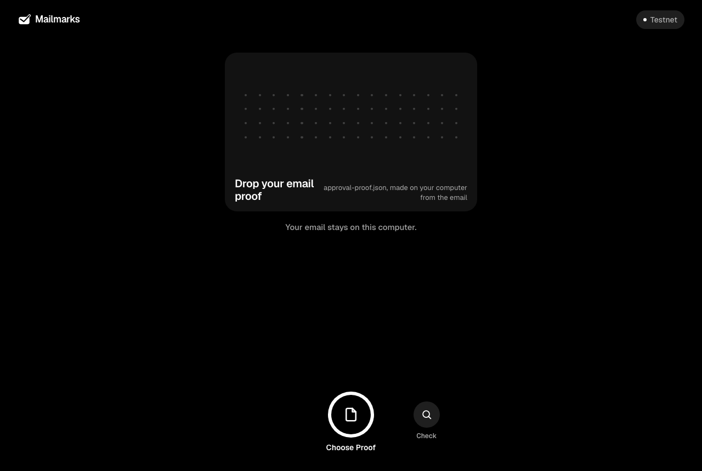
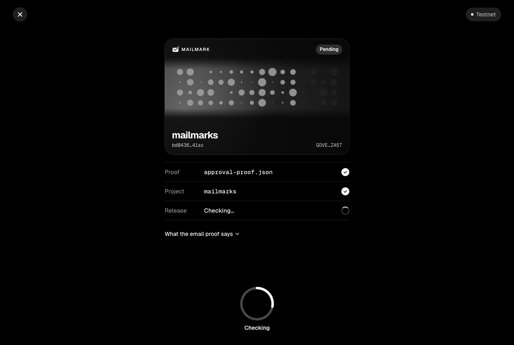
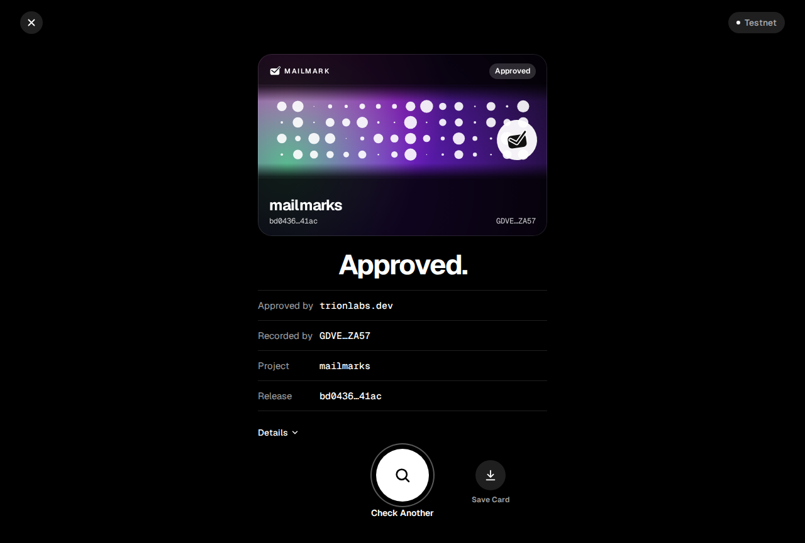

# mailmarks

Mailmarks turns one DKIM-signed approval email into a release approval on Stellar testnet. Any contract can read that
approval with `is_approved(project_id, artifact_hash)`.

You prove the email on your own computer, offline. Only the proof and its seven public values leave it. You then drop
the proof on a static page, sign with your Stellar wallet, and the approval registry records it once its Groth16 check
passes. There is no backend and no email upload. Testnet only.

**Trust model.** The configured sender and its DKIM provider are trusted to issue the approval. The record proves that
the signed message approves that artifact for that wallet. It says nothing about the software's quality. The sender, the
provider and anyone who holds the email can link it to the public record (the nullifier is derived from its signature). The Groth16 key comes from one phase-2 contribution, so a
public ceremony and an audit come before any mainnet use.

## From nothing to a recorded approval

### 1. Install

```sh
git clone https://github.com/yamancan/mailmarks-stellar mailmarks && cd mailmarks
nvm install                     # Node from .nvmrc (needs nvm: github.com/nvm-sh/nvm)
npm ci --ignore-scripts --prefix prover && npm ci --ignore-scripts --prefix web
```

After installing nvm, open a new terminal before running the commands above. Loading nvm from inside `mailmarks/`
before the Node version in `.nvmrc` is installed stops with exit 3. The full walkthrough is in [docs/setup.md](docs/setup.md).

Proving in Docker instead needs Docker and a prover image, not the prover's npm packages. The contract tests need Rust
1.99.1 (`docs/toolchain.md`).

**What this repository alone lets you run.** The delivery proving files (the zkey is 456 MB) and the delivery Docker
image are not published; both are available on request. From the repository alone you can go as far as a proof verified
locally with the DEV key:

```sh
npm ci --ignore-scripts --prefix circuits    # besides prover/ and web/ above; circom 2.2.3 must be on PATH
bash circuits/scripts/dev-setup.sh          # the DEV key (downloads and checks the 1.2 GB ptau)
node prover/scripts/make-test-email.js try  # try/approval.eml and its key record in try/keys/
npm run prove --prefix prover -- try/approval.eml --keys try/keys   # proves it and checks it with the DEV key
```

([docs/setup.md](docs/setup.md), steps 3–5.) The page's **Record** step cannot use that proof: the deployed registry
holds the delivery key and rejects a DEV proof. The delivery itself is shown by the recorded deployment
([docs/deployments/](docs/deployments/README.md)) and its evidence (below).

### 2. Send the approval email

From the configured sender, send an email whose Subject is exactly

```
emailmark <project_id> <artifact_sha256> <wallet>
```

`artifact_sha256` is the SHA-256 of the release file (`sha256sum <file>`). `wallet` is the Stellar account that will
sign, and no other account can use this email. The body is ignored. Save the received message as an `.eml` file on
your computer (your mail client's "Download message" or "Show original"). The rules and the reference approval
(`reference/hello-release-0.1.0.mjs`) are in [docs/template.md](docs/template.md).

### 3. Prove it offline

With Node:

```sh
npm run prove --prefix prover -- <approval.eml> [--out approval-proof.json]
npm run prove --prefix prover -- approval.eml       # writes approval-proof.json next to the email
```

Or with Docker, with networking off. The image is built from this repository after the proving files are in
`circuits/build/` ([docs/prover.md](docs/prover.md), "Docker"); the delivery image file is available on request:

```sh
docker load -i mailmarks-prover-amd64.tar      # the delivery image file, on request
docker run --rm --pull=never --platform linux/amd64 --network none --user "$(id -u):$(id -g)" \
  -v "$PWD:/work" mailmarks-prover:amd64 approval.eml   # writes ./approval-proof.json
```

The Node path also needs the proving files in `circuits/build/`, which are not in git: the delivery files (on request;
[docs/setup.md](docs/setup.md) lists their hashes), or the DEV key (`bash circuits/scripts/dev-setup.sh`) for a
test-key email ([docs/setup.md](docs/setup.md), step 3). The Docker image carries them.

The prover checks the DKIM signature against the key pinned in the repo (`prover/keys/`), so it needs no network. Before
proving it checks every rule of the circuit and stops with a plain message when one fails. It shows its progress while
proving and writes one file, `approval-proof.json` ([docs/approval-proof.md](docs/approval-proof.md)). The email stays
where it is. Details, the Docker image and the proving files: [docs/prover.md](docs/prover.md).

### 4. Run the page

```sh
npm run preview --prefix web    # builds web/dist and serves http://localhost:4173
```

The page reads the testnet deployment from `docs/deployments/testnet.json`. The page itself, the Stellar RPC,
Friendbot (only after you click "Get Free XLM") and the popups of the wallet you pick are the only places it talks to
([web/README.md](web/README.md)).

The screenshots below come from the page's test harness (`web/e2e/`): a test wallet (`GDVE…ZA57`) and a test RPC, not
the real deployment. The real transactions are in "Evidence".



### 5. Drop approval-proof.json and approve

The start screen records an approval. Drop `approval-proof.json` on the **Drop your email proof** card, or use **Choose
Proof**. If you drop an `.eml` file instead, the page refuses it: "That is the email itself. It stays on your
computer. Drop the proof made from it: approval-proof.json." The page reads the proof file, then checks on Stellar whether the release is already
approved (the Proof, Project and Release rows, with Release "Checking…").



When the release is not approved yet, the page shows Release "Not approved yet", Wallet "Use G…" (the wallet the
email names) and **Connect Wallet**. That opens the wallet list (Stellar Wallets Kit: Varial, formerly Freighter, then
xBull, Albedo, Hana and Rabet). Use the wallet the email names; any other one is shown as the wrong row. A new testnet
account can get free Test XLM in one click (**Get Free XLM**). The page dry-runs the transaction ("Making sure it will
go through"), then shows **Everything checks out** with the fee, and **Record**.


**Record** asks your wallet to sign ("Confirm in your wallet.") and sends it. When the network confirms, the page shows
**Recorded.** "Any app can now check this release.", with a link to the transaction on Stellar Expert.


### 6. Check the status

On the start screen, **Check** (Check a release) opens **Is it approved?**. Drop the release file (it is hashed on your computer, and only
its SHA-256 is sent, to look it up on Stellar) or paste its checksum. An approved release shows **Approved.** with Approved by, Recorded by, Project and Release.



A contract asks the same question with `is_approved(project_id, artifact_hash)` on the approval registry. The
consumer contract in `contracts/consumer` shows the call.

## Tests

```sh
npm ci --ignore-scripts --prefix circuits && npm test --prefix circuits   # circuit (needs circom 2.2.3; the Groth16 test needs the DEV key)
npm test --prefix shared        # encoder and approval-proof.json format
npm test --prefix prover        # prover
npm test --prefix web           # page and evidence script (unit)
npx --prefix web playwright install chromium   # once, for the e2e tests
npm run e2e --prefix web        # page in Chromium with a fake RPC and wallet (Playwright 1.62.1)
cargo test --locked --manifest-path contracts/Cargo.toml   # contracts: the six rejection tests and the consumer call
```

`.github/workflows/contracts.yml` runs the same cargo test on GitHub, by hand (workflow_dispatch) and on pull requests to
`main`.

## What the scope asks for, and where it is

The scope: [docs/scope.md](docs/scope.md). Each acceptance item, its evidence and what is still waiting:
[docs/delivery.md](docs/delivery.md).

| Deliverable | In this repo |
|---|---|
| 1. Circuit and local prover: CLI and Docker image, offline, one template and sender | `circuits/`, `prover/`, `Dockerfile`, [docs/template.md](docs/template.md), [docs/approval-proof.md](docs/approval-proof.md), [docs/toolchain.md](docs/toolchain.md), [docs/dkim-key.md](docs/dkim-key.md), `docs/public-input-vectors.json`, sample proof `docs/fixtures/approval-proof.sample.json` |
| 2. Soroban contracts: Groth16 verifier, fixed-key DKIM registry, approval registry, consumer | `contracts/groth16-verifier`, `contracts/dkim-registry`, `contracts/approval-registry` (with the six rejection tests), `contracts/consumer`, [docs/contract-storage.md](docs/contract-storage.md), [docs/deploy.md](docs/deploy.md) |
| 3. Static submission page, README walkthrough, testnet evidence | `web/`, this README, `docs/evidence/` (below) |

## Evidence

Stellar testnet is reset on 16 Dec 2026. After that the contracts, the transactions and the Stellar Expert links below
are gone; the records in `docs/evidence/` (RPC and Horizon answers, screenshots) stay.

- [docs/deployments/README.md](docs/deployments/README.md): the testnet deployment of 21 Nov, its four contracts and
  their transactions.
- [docs/evidence/README.md](docs/evidence/README.md): the valid approval and the five rejected transactions. For each
  one: the registry's result, the hash, the Stellar Expert link and the full RPC and Horizon records.
  - Valid approval, recorded from the page with the owner's wallet: [179c5f49…](https://stellar.expert/explorer/testnet/tx/179c5f492ad67c5ba541d56eb3826b467564517b1fc304ddc37bc45eb86f22a2)
  - Replay of the same email, NullifierUsed #6: [5d2d0100…](https://stellar.expert/explorer/testnet/tx/5d2d010091b94d26b03317ec8311b8b2bdd0215dd096a15d14ffa602c08847be)
  - Wrong project #3, unregistered DKIM key #5, wrong artifact #8, tampered proof #8: in the evidence README.
- [docs/fixtures/approval-proof.json](docs/fixtures/approval-proof.json): the real proof of the reference approval,
  made from the owner's email (public data only: fields, public signals, proof).
- [docs/evidence/contract-tests/cargo-test.txt](docs/evidence/contract-tests/cargo-test.txt): the full `cargo test`
  output on the delivered contracts, after the deployment: 23 passed, 1 ignored (the WASM measurement,
  docs/contract-storage.md).
- [docs/evidence/testnet-check.txt](docs/evidence/testnet-check.txt): after the valid approval, the consumer's
  `release_allowed` (which calls the registry's `is_approved`) and `is_approved` itself return `true` for the reference
  artifact, and `false` for a changed hash.
- [docs/setup.md](docs/setup.md): the clean-machine rehearsal, a new linux/amd64 container on the Mac going from
  nothing to `approval-proof.json` with a test-key email (20 Nov). The owner's email was proved in the delivery image
  on 21 Nov ([docs/docker.md](docs/docker.md)), and the setup steps were run again with it in a new container on the
  final deployment, ending with `is_approved` true.
- The page step from a clean machine was not done; the approval was recorded from the page on the owner's Mac
  ([docs/delivery.md](docs/delivery.md), "Clean machine without the page step").

## License

MIT ([LICENSE](LICENSE)). `contracts/groth16-verifier` is Apache-2.0, from SDF's soroban-examples
([its NOTICE](contracts/groth16-verifier/NOTICE)).

The circuit and the prover use GPL-3.0 packages: snarkjs, circomlib (through `@zk-email/circuits`) and circomlibjs
(through `@zk-email/helpers`). They are npm dependencies, not part of this repository. Whoever distributes the compiled
circuit, its proving files or the Docker image, which contain or are built from them, takes on the GPL-3.0 obligations,
such as offering the corresponding source.
