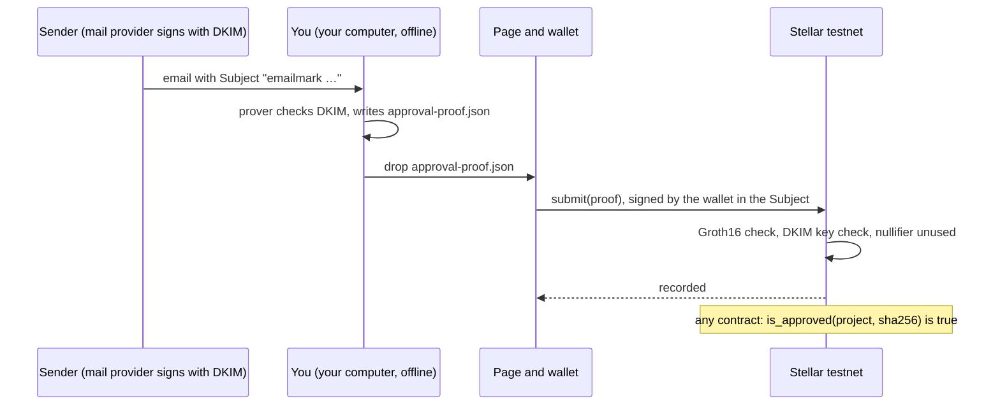
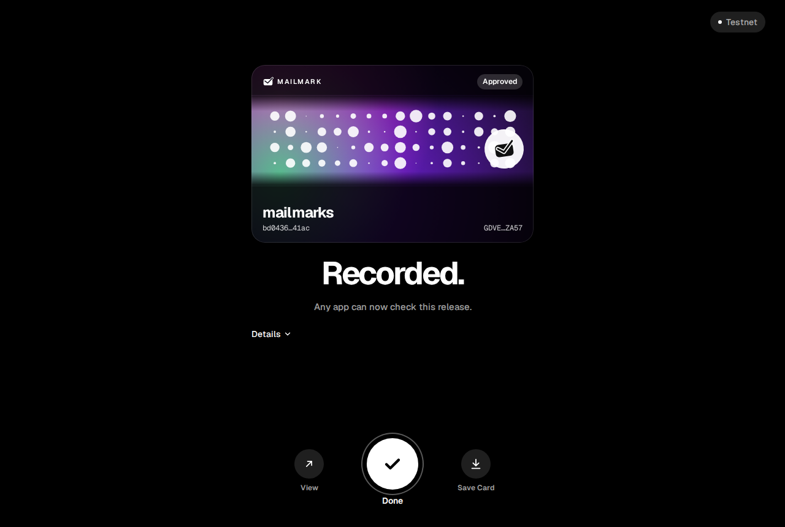
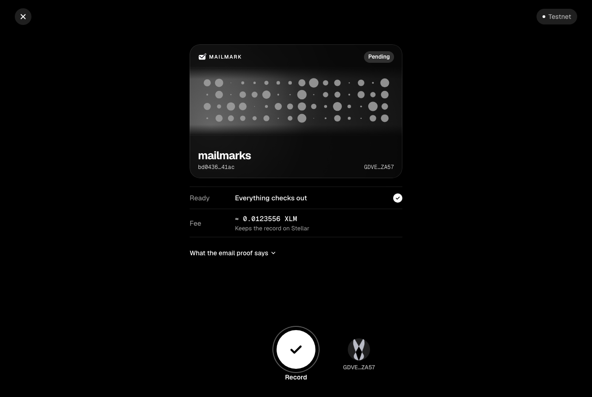

<h1 align="center">mailmarks</h1>

<div align="center">

**Prove an email on Stellar, without showing it.**

For developers who want an on-chain fact from a signed email. Live on Stellar testnet.

**[Run it from nothing →](#run-it)**

</div>

You prove on your own computer, offline, that a real email arrived from a known sender with an exact Subject line.
Only a zero-knowledge proof leaves the machine. A Stellar contract checks it and records the fact; the email, its
headers and its body never do.

```text
email.eml            ──  npm run prove (offline)   ──▶  approval-proof.json
approval-proof.json  ──  page + your wallet        ──▶  recorded on Stellar testnet
any contract         ──  is_approved(project, sha256)  ──▶  true
```

<sub>The three steps, from a saved `.eml` file to a contract that reads the result.</sub>

The email is the signature. Mail providers already sign every message with DKIM; mailmarks turns that signature into
a Groth16 proof a Soroban contract can verify, so an email you already know how to send becomes something a contract
can trust. There is no backend and no upload.

| Try it | See it working | Check it yourself |
|---|---|---|
| [Run it](#run-it) | [The recorded email proof on testnet](https://stellar.expert/explorer/testnet/tx/179c5f492ad67c5ba541d56eb3826b467564517b1fc304ddc37bc45eb86f22a2) | `cargo test --locked --manifest-path contracts/Cargo.toml` |

**Reading the code, or sending an agent to read it?** The hard part is the circuit,
[`circuits/approval.circom`](circuits/approval.circom): DKIM over the signed header, then the From and Subject read
at offsets the circuit checks itself. The prover is [`prover/src/prove.js`](prover/src/prove.js); the contract that
checks and records is [`contracts/approval-registry/src/lib.rs`](contracts/approval-registry/src/lib.rs) (`submit`,
`is_approved`); the page is [`web/src/flow.ts`](web/src/flow.ts). Every test command is under [Tests](#tests).

## What one email proves

The Subject line carries the fact. This release ships one template, a release approval:

```text
emailmark <project_id> <artifact_sha256> <wallet>
```

One email from the configured sender with this Subject proves that the sender vouches for the file with that SHA-256,
in that project, and that only that Stellar wallet may record it. Once recorded, any contract asks
`is_approved(project_id, artifact_hash)`; [`contracts/consumer`](contracts/consumer/src/lib.rs) shows the call.

The configured sender is `mintmarks@trionlabs.dev` (DKIM domain `trionlabs.dev`). The rules for each field, the
reference email and the seven public values are in [docs/template.md](docs/template.md).

<details>
<summary>What is trusted, and what is public</summary>

- The configured sender and its DKIM provider are trusted to send the email. The record proves what the signed
  Subject says; it says nothing about the file's quality.
- Public: the seven public values (wallet, project, file hash, DKIM key hash, nullifier) and the transaction.
- The nullifier comes from the email's DKIM signature, so one email records once. It also means the sender, the
  provider and anyone holding the email can link it to the record.
- The Groth16 key comes from one phase-2 contribution. A public ceremony and an audit come before any mainnet use.

</details>

## How it works



## Run it

### 1. Install

```sh
git clone https://github.com/yamancan/mailmarks-stellar mailmarks && cd mailmarks
nvm install                     # Node from .nvmrc (needs nvm: github.com/nvm-sh/nvm)
npm ci --ignore-scripts --prefix prover && npm ci --ignore-scripts --prefix web
```

Open a new terminal after installing nvm. The full walkthrough is in [docs/setup.md](docs/setup.md); the contract
tests need Rust 1.99.1 ([docs/toolchain.md](docs/toolchain.md)).

**Try the whole proving path with a test email.** This repository builds a DEV key and a throwaway test email, and
proves it locally:

```sh
npm ci --ignore-scripts --prefix circuits    # circom 2.2.3 must be on PATH
bash circuits/scripts/dev-setup.sh          # the DEV key (downloads and checks the 1.2 GB ptau)
node prover/scripts/make-test-email.js try  # try/approval.eml and its key record in try/keys/
npm run prove --prefix prover -- try/approval.eml --keys try/keys
```

The deployed contract holds the delivery key, so it records proofs made with the delivery proving files (the zkey is
456 MB) and refuses DEV proofs. The delivery files and the delivery Docker image are available on request;
[docs/setup.md](docs/setup.md) lists their hashes.

### 2. Send the email

From the configured sender, send an email whose Subject is exactly `emailmark <project_id> <artifact_sha256> <wallet>`.
`artifact_sha256` is `sha256sum <file>`; `wallet` is the Stellar account that will record it. The body is ignored.
Save the received message as an `.eml` file (your mail client's "Download message" or "Show original").

### 3. Prove it offline

```sh
npm run prove --prefix prover -- email.eml       # writes approval-proof.json next to the email
```

Or in Docker with networking off, with an image built from this repository ([docs/prover.md](docs/prover.md), "Docker"):

```sh
docker run --rm --pull=never --platform linux/amd64 --network none --user "$(id -u):$(id -g)" \
  -v "$PWD:/work" mailmarks-prover:amd64 email.eml
```

The prover checks the DKIM signature against the key pinned in [`prover/keys/`](prover/keys), checks every rule of
the circuit before proving, and writes one file, `approval-proof.json`
([docs/approval-proof.md](docs/approval-proof.md)). The email stays where it is. Details:
[docs/prover.md](docs/prover.md).

### 4. Record it from the page

```sh
npm run preview --prefix web    # serves http://localhost:4173
```


<sub>The page from its test harness (`web/e2e/`): a test wallet and a test RPC. The real transactions are under
Evidence.</sub>

Drop `approval-proof.json` on **Drop your email proof**. The page checks it against Stellar, asks for the wallet the
email names (**Connect Wallet**; **Get Free XLM** funds a new testnet account), dry-runs the transaction, and
**Record** sends it. The `.eml` itself is refused: it stays on your computer.



The page talks only to the Stellar RPC, Friendbot (after **Get Free XLM**) and the wallet you pick
([web/README.md](web/README.md)). It reads the deployment from
[docs/deployments/testnet.json](docs/deployments/testnet.json).

### 5. Check it

**Check** on the start screen takes the file (hashed on your computer) or its checksum and shows **Approved.** with
who sent the email and who recorded it. A contract asks the same with `is_approved(project_id, artifact_hash)`.

<details>
<summary>The other screens</summary>





</details>

## Tests

```sh
npm ci --ignore-scripts --prefix circuits   # once
npm test --prefix circuits      # circuit (circom 2.2.3; the Groth16 test needs the DEV key)
npm test --prefix shared        # encoder and approval-proof.json format
npm test --prefix prover        # prover
npm test --prefix web           # page and evidence script
npx --prefix web playwright install chromium && npm run e2e --prefix web   # page in Chromium
cargo test --locked --manifest-path contracts/Cargo.toml   # contracts, rejections included
```

[`.github/workflows/contracts.yml`](.github/workflows/contracts.yml) runs the cargo tests on pull requests to `main`.

## Evidence

All on Stellar testnet, deployed 20 Nov 2026 (UTC). Testnet resets on 16 Dec 2026; the full RPC and Horizon records in
[docs/evidence/](docs/evidence/README.md) stay.

| Claim | Evidence |
|---|---|
| A real email, proved and recorded from the page | [179c5f49…](https://stellar.expert/explorer/testnet/tx/179c5f492ad67c5ba541d56eb3826b467564517b1fc304ddc37bc45eb86f22a2) |
| The same email cannot record twice (NullifierUsed #6) | [5d2d0100…](https://stellar.expert/explorer/testnet/tx/5d2d010091b94d26b03317ec8311b8b2bdd0215dd096a15d14ffa602c08847be) |
| Wrong project, unknown DKIM key, wrong file, tampered proof are refused | [docs/evidence/](docs/evidence/README.md) |
| A contract reads the result: `true` for the file, `false` for a changed hash | [testnet-check.txt](docs/evidence/testnet-check.txt) |
| The four contracts and their deployment | [docs/deployments/](docs/deployments/README.md) |
| Contract tests on the delivered code: 23 passed, 1 ignored | [cargo-test.txt](docs/evidence/contract-tests/cargo-test.txt) |
| The proof of the real email (public values only) | [approval-proof.json](docs/fixtures/approval-proof.json) |

<details>
<summary>Scope and delivery</summary>

The scope is in [docs/scope.md](docs/scope.md); each acceptance item and its evidence is in
[docs/delivery.md](docs/delivery.md).

- **Circuit and prover** (CLI and Docker, offline): `circuits/`, `prover/`, `Dockerfile`,
  [docs/circuit.md](docs/circuit.md), [docs/dkim-key.md](docs/dkim-key.md),
  [docs/toolchain.md](docs/toolchain.md).
- **Soroban contracts**: `contracts/groth16-verifier`, `contracts/dkim-registry`, `contracts/approval-registry`,
  `contracts/consumer`, [docs/contract-storage.md](docs/contract-storage.md), [docs/deploy.md](docs/deploy.md).
- **Page and evidence**: `web/`, this README, `docs/evidence/`.
- **Clean machine**: a new linux/amd64 container went from nothing to `approval-proof.json` with a test email
  (20 Nov) and with the real email in the delivery image (21 Nov), ending with `is_approved` true
  ([docs/setup.md](docs/setup.md), [docs/docker.md](docs/docker.md)). The page step was run on the owner's Mac.

</details>

## License

MIT ([LICENSE](LICENSE)). `contracts/groth16-verifier` is Apache-2.0, from SDF's soroban-examples
([NOTICE](contracts/groth16-verifier/NOTICE)).

The circuit and prover depend on GPL-3.0 npm packages (snarkjs, circomlib, circomlibjs). Whoever distributes the
compiled circuit, its proving files or the Docker image takes on the GPL-3.0 obligations, such as offering the source.
